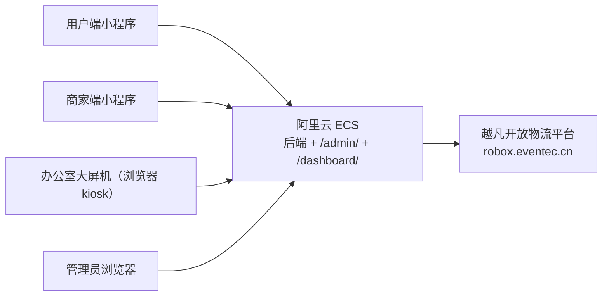

# 会话交接文档 17

> 写给下一个 agent 会话。请从头读完本文档再动任何代码。
> 生成时间：2026-10-11（承接 `交接文档16.md`，16 的内容依然有效，**本文只写 16 之后的现状变化**）。
> 本文**只描述项目现状与已确认的决策**，不含过程叙述。凡是写"已核实"的条目都是当场查过代码 / 接口 / 数据库得到的，可以直接信任。

---

## 0. 最重要的四条规矩（先记住）

1. **全程中文思考、中文回复。**
2. **绝不重复调用同一个工具。** 同一命令 / grep / read 只发一次。历史上两次会话因无意义重复调用被用户点名批评。
3. **改中文文件禁止用 shell 读写。** `Get-Content` / `Set-Content` / `Out-File` / `>` 会按 GBK 解码 UTF-8，中文变乱码，而且**会吃掉 `<` 字符**（2026-10-09 因此把 `index.html` 写坏、地图高度塌成 0）。一律用 `read` / `edit` / `write`，或写 `.mjs` 用 Node 按字节读写。
4. **改代码前先 `read`；改完必须用真实浏览器 CDP 探针回归**，`node --check` 只算语法检查。git 只 `git add` 精确路径，**提交必须先得到用户明确点头**。

---

## 1. 项目是什么（一句话版）

校园场景的**无人车送餐 / 校内快递配送**系统。用户在微信小程序下单，商家端接单备货，后端把配送任务下发给**越凡（robox）开放物流平台**，由真实无人车执行配送；一台挂在办公室的**可视化大屏**实时展示车的轨迹与订单状态。

| 部分 | 位置 | 技术栈 |
| --- | --- | --- |
| 后端 | `校内快递配送机器人/backend/` | Node + Express + 内置 `node:sqlite`，端口 **3000** |
| 用户端小程序 | `校内快递配送机器人/用户端/` | 微信小程序 |
| 商家端小程序 | `校内快递配送机器人/商家端/` | 微信小程序 |
| 管理员网页 | `校内快递配送机器人/管理员网页/` | 原生 web（后端静态托管 `/admin/`） |
| 可视化大屏 | `校内快递配送机器人/可视化大屏/` | 零构建 vanilla JS + WebGL2 3D 地图（后端静态托管 `/dashboard/`） |
| 模拟器 | `校内快递配送机器人/simulator/` | 模拟小车 |

- **会话工作目录**：`D:\01_Code\Personal\Software\送餐无人车`
- **git 仓库根**：`D:\01_Code\Personal\Software\送餐无人车\校内快递配送机器人`（分支 `main`，远端 `VesselPaper/lingdong-delivery-miniprogram`）。**两者不是同一个目录，别搞混。**
- 后端**一个进程托管三个前端**：小程序 API 走 `/api`、管理员页走 `/admin/`、大屏走 `/dashboard/`。这是当前部署形态的关键（见 §4、§5）。

---

## 2. 当前运行形态（现在就是这么跑的）

| 项 | 现状 |
| --- | --- |
| 后端位置 | **办公室的一台电脑上**，`node server.js`，监听 `0.0.0.0:3000` |
| 运行模式 | `RUN_MODE=pilot`，连接**生产**平台 `robox.eventec.cn`（配了 `ALLOW_UNSAFE_PROD_PLATFORM=true` 逃生舱） |
| 登录 / 支付 | 都是**模拟**（`PAY_MOCK=true`，无真实资金流） |
| 平台对接 | **真实**：真车会被真实调度 |
| 大屏 | 同一台电脑或另一台电脑上，用 kiosk 全屏浏览器打开 `http://后端地址:3000/dashboard/` |
| 虚拟车 | `.env` 里 `VIRTUAL_ROBOT=1` —— 联调用，**上线前必须关**（见 §5） |

**大屏的真实形态（很容易误解，务必先理解）**：大屏不是"本地渲染的离线页面"，它是**从后端服务器加载的普通网页**。`可视化大屏/deploy/启动大屏.bat` 第 25 行 `TARGET=%BASE%/dashboard/`，页面里所有接口在 http 下走**同源相对路径** `/api/...`（`可视化大屏/js/dashboard/shared.js` 第 34–45 行，只有 `file://` 双击时才回退到 `127.0.0.1:3000`）。因此后端搬到哪里，大屏的接口就自动跟着到哪里，**不需要改前端代码**——办公室那台机器只出一个浏览器。

---

## 3. 平台回调地址：当前是关闭状态（重要）

`.env` 第 11 行 `PLATFORM_CALLBACK_BASE=` **为空**。已核实后果链：

- `backend/services/platform-http.js` 第 19 行读该变量，第 42–47 行 `callbackUrl()` 在为空时**返回空字符串**。
- 于是 `backend/services/platform.js` 的 136/241/603 三处建单体里，`feedbackDeliveryTaskUrl`（平台→我们的状态回调）和 `checkBizOrderStatusUrl`（设备端查单、用于退款强制关任务）**都是空串**。
- **平台并不拒绝**：`backend/server.out.log` 第 8 行有成功记录（`platformTaskId=1263738302861376`），当前订单状态靠 `delivery/timers.js` 第 69 行**每 8 秒轮询** `basicList` 兜底推进（`PLATFORM_POLL_MS` 默认 8000）。
- **数据库佐证轮询有效**：`delivery_tasks` 里 `task_status=80` 有 23 条；`orders` 里已送达(4) 有 50 单。

**待澄清的隐患**：若一直不配回调，用户在机器人待取餐期间申请退款时，平台没有机会问我们"这单还算数吗"，理论上存在"钱退了、餐照送"的窗口（本地取消后 8 秒内会补发 `forceCloseTask`，但不是即时）。**上云之后应把该地址补上**（见 §4）。

**若要启用回调，必须先加一道保护**：回调与 8 秒轮询会同时往 `platform-callbacks.js` 的 `applyStatus()` 灌状态，同状态重写是幂等的，但平台回调**报文乱序**时可能把状态打回去，所以需要一条"`task_status` 单调不回退"的守卫。

---

## 4. 上线计划：后端迁阿里云 ECS

这是当前**最主要的未完成工作**（`doc/上线计划/` 下已有 01–07 多份方案文档，可先读）。

### 4.1 目标拓扑

后端、管理员页、大屏页面**一起上云**（因为后端托管它们）；小程序在用户手机上；办公室机器只保留浏览器 + `服务器地址.txt` 指向云端域名。

### 4.2 上云只需要改 4 处

| 位置 | 现在 | 改成 |
| --- | --- | --- |
| `用户端/utils/config.js` 第 15 行 | `https://请换成你的域名/api` | 真实域名 |
| `商家端/utils/config.js` 第 14 行 | 同上 | 真实域名 |
| `backend/.env` 第 11 行 | `PLATFORM_CALLBACK_BASE=`（空） | `https://域名` |
| `backend/.env` 支付段 | `WXPAY_NOTIFY_URL` 注释着 | 接真实支付时填 `https://域名/api/pay/notify` |

服务器侧另设两个**代码里已经预留好**的环境变量：`BIND_HOST=127.0.0.1`（`server.js` 第 172 行）、`TRUST_PROXY=1`（`domains/admin/routes.js` 第 42 行取真实 IP 用）。反向代理后 `CORS_ORIGINS` 默认同源即可，不用动。

### 4.3 迁移的数据（总量很小，不到 25 MB）

| 内容 | 大小（实测） | 说明 |
| --- | --- | --- |
| `backend/data/lingdong.db` + `-wal` + `-shm` | 主库 364 KB，**WAL 3.9 MB** | **必须停服后连 `-wal` 一起拷**，否则丢最新写入 |
| `backend/data/map-recon.json` | 5.2 KB | 大屏 3D 重建地图 |
| `backend/data/admin-calib.json` | — | 定位标定 |
| `backend/uploads/`、`backend/seed_images/` | 约 17.5 MB | 商品图、二维码 |
| `backend/.env` | — | **不在 git 里，必须单独传** |
| `可视化大屏/assets/map-calibration.js` | — | 不在 git 里（`platform-http.js` 第 708 行会读） |

### 4.4 服务器规格（按后端实测负载定的）

后端的实际负载**很低**：依赖只有 `express` + `cors`，无编译型模块；最大的表 90 条订单；最大持续开销是每 8 秒一轮的平台查询。

- CPU / 内存：**2 核 4G** 足够（2 核 2G 能跑但峰值紧）。成都地域，具体价格以下单时为准。
- 磁盘：**40G**。带宽：按量 3–5 Mbps。
- 系统：**Ubuntu 22.04 / 24.04**。
- **Node 必须 ≥ 22.13**，建议 **24 LTS**。原因：代码用的是 Node 内置 `node:sqlite`（`backend/db.js` 第 2 行），该模块 **v22.5.0 才加入、v22.13.0 才不需要 `--experimental-sqlite`**。
  - 已核实代码**只用** `prepare` / `run` / `get` / `all` / `exec` / `close`，**没有**用到 `iterate` / `backup` / `aggregate` / `setReadBigInts` / `timeout` 选项等较新 API，所以 22.13+ 与 24 都兼容。
  - **不要选 Alibaba Cloud Linux 自带的老 Node**，会直接起不来。

### 4.5 时间与前置条件

- **纯技术搬运约 1 天**（装环境 → 传代码 → 传数据 → 改 4 处配置 → 真下一单回归）。
- **真正的长尾是行政**：域名备案 **7–20 个工作日**；微信小程序正式版**只认 https 域名、不接受 IP**，且要在微信公众平台把域名加进 **request 合法域名 + socket 合法域名**（商家端实时推送走 WebSocket，`商家端/utils/push.js` 第 20 行会自动把 https 推导成 wss）。
- **过渡方案**（不想等备案）：先只把后端迁到云上用 **IP + 端口**跑，办公室大屏与管理员页切过去，小程序继续连办公室电脑；备案下来后再改那两行 `config.js`。
- **一个需要外部确认的前置条件**：回调地址一旦填上，平台会主动 POST 到我们的域名。**此前从未启用过，需向越凡确认他们的回调配置 / 白名单是否接受我们的地址。**

---

## 5. 上线前必须处理的开关（已核实）

| 位置 | 现在 | 上线前 |
| --- | --- | --- |
| `backend/.env` 第 53 行 `VIRTUAL_ROBOT` | `=1` | **必须置 0 或删除**。否则线上会多出一台不存在的模拟车，大屏和管理页都会显示它 |
| `backend/.env` `PAY_MOCK` | `=true` | 接真实收款前必须改为配置微信支付四要素并删除本行 |
| `backend/.env` `RUN_MODE` | `pilot` | 正式运营改 `production`（会强制要求支付四要素齐备、平台凭据齐备、回调防伪令牌可派生） |
| `backend/.env` `ALLOW_UNSAFE_PROD_PLATFORM` | `=true` | 这是连生产平台的逃生舱，正式档下不再需要 |

已有一个可直接跑的**上云前置自检脚本**：`_tmp4\probes\tools\preflight.mjs`（在目标服务器上运行，只读检查 Node 版本、`node:sqlite` 可用性、三个前端目录是否齐全、数据文件与 WAL、写权限、端口占用、以及上面 4 个 `.env` 开关）。本地跑过一次，唯一报红的就是 `VIRTUAL_ROBOT=1`。

---

## 6. 办公室电脑（大屏机）配置：已定稿、已进入采购

两台**完全同配置**，一主一备（另一台平时不显示数据，作为主机的备份）。

- **配置单文件**：`项目进度\电脑配置单.docx`（纯文本无装饰的 Word，2026-10-11 定稿，用户自己又改过一版）。
- **状态**：配置单已交给负责人，负责人已按该单采购。已收到并核对过一轮**实际采购清单**，结论是**可以买**。
- **大屏的硬件需求其实很轻**：资源约 8 MB，17 栋楼 + 5 台车，`antialias:true`、无阴影贴图 / 无后处理 / 无反射，唯一大纹理是 1800×1682 的雷达底图。加独显是为了后期大屏做得更好看，不是为了现在的负载。

### 6.1 已核实的采购配置（作为"当前实际装机方案"记录）

Intel 酷睿 Ultra 7 265K（盒装）｜华硕 TUF GAMING B860M-PLUS WIFI｜微星 RTX 5070 Ti 16GB VENTUS 3X OC｜金士顿 FURY Beast **64GB（2×32GB）DDR5 6000 CL30**｜致态 TiPlus7100 1TB｜希捷酷狼 4TB｜振华 LEADEX III 850W 金牌全模组 ATX3.1｜利民 FC140 双塔风冷｜先马黑洞 PRO｜AOC U27G4F 27" 4K｜山特 C1K（1000VA/800W 纯正弦波）｜罗技 MK120（用户已知其非机械键盘，暂不更换）

### 6.2 交付时必须交代装机商 / 必须做的检查（**两条硬要求**）

1. **BIOS 功耗墙**：265K 满载 PL2 为 250W。**必须把 PL1=125W、PL2=200W 设死，并关闭主板自动超频 / 性能增强**。不设会长时间冲到 95℃ 并周期性降频，大屏挂一天即可观察到。
2. **系统必须是 Windows 11 专业版**（远程桌面服务端、BitLocker、组策略都需要）。家庭版没有 RDP 服务端，日后无法远程管理这台机器。

其余需现场确认的点：

- **内存必须是低矮马甲**（≤34 mm）。FC140 是双塔、体积很大，紧贴内存插槽；配置单里指定金士顿 FURY Beast 正是为此，**不要换成高马甲条**。
- **显卡必须是 16GB 版**。RTX 5070 Ti = 16GB，RTX 5070 = 12GB，同核心不同显存，"没货了给你换 5070"是常见降级套路。
- **电源必须有原生 12V-2×6（PCIe 5.x 16pin）接口**。已核实微星 PAG G750LS 是原生双 16pin（450W），无需转接线。
- **显示器走 DP 1.4 线**接显卡（4K 高刷靠 DP + DSC），4K 输出无坏点。
- **NVIDIA 只装 Studio 驱动并关闭自动更新**（RTX 50 系有一批黑屏 / 风扇满转报告）。
- 24 小时烤机（含大屏 3D 持续运行的场景）+ 断电测试 UPS。

### 6.3 交付后的运维约定

- 1 号机拉网线（有线优先），2 号机走 WiFi；路由器做 DHCP 静态绑定。
- 大屏连的后端地址写在 `可视化大屏\deploy\服务器地址.txt` 第一行（`启动大屏.bat` 第 15 行读它）。**IP 变了只改这一行**；`看门狗.ps1` / `安装开机自启.ps1` 也在同目录。
- **绝不允许两台机器同时跑后端**（会造成 SQLite 双写、重复拉单与重复连平台），启动 2 号机前必须先关 1 号机。
- 需要备份的内容：`backend/data/*.db`、`backend/data/map-recon.json`、`backend/.env`、`backend/uploads/`、`可视化大屏/`（含 `deploy/`）。

---

## 7. 代码与数据现状（已核实）

| 项 | 状态 |
| --- | --- |
| git | 本地 `main` 与 `origin/main` **0 ahead / 0 behind**，最近提交 `d851758` |
| 工作区未提交 | **一批 10/8 的上线工作旧改动**：已暂存 12 个文件（`backend/.env.example`、`backend/domains/admin/service.js`、`backend/services/autoLoad.js`、`backend/services/platform.js`、`doc/07_配送平台对接.md`、`doc/上线计划/01–06` 与 `README.md`）；未跟踪的有 `doc/上线计划/00_上线对接信息清单.md`、`07_上线操作手册.md`、`doc/文档/`、`doc/老师沟通调整/`、以及 `交接文档13–16.md`。**这批改动全程没人碰过，是否提交需用户明确点头。** |
| 后端测试 | **10 个测试文件全部通过（exit 0）**：`test_audit_mw`、`test_batch_flow`、`test_batch_v2_e2e`、`test_batch_v2_invariants`、`test_batch_v2_timing`、`test_cancel_tasks`、`test_control_ctrlid`、`test_order_ahead`、`test_status_events`、`test_summon_flow`。跑法：在 `backend/` 下逐个 `node tests\xxx.js`（本机 Node 为 v24.21.0） |
| 数据库 | `backend/data/lingdong.db` 364 KB + WAL 3.9 MB；`delivery_tasks` 状态分布：0→1、80→23、110→63、150→2；`orders` 状态分布：配送中(2)→2、已完成(4)→50、已取消(5)→90、已退款(7)→1 |
| 大屏版本号 | `map3d-gl.js?v=3d85`、`map-calibration.js?v=3d43`、`recon.js?v=3d79`、`map3d-entry.js?v=3d43`、`css?v=3d2`（详见 `index.html`）。零构建靠 `?v=` 刷缓存，**用户浏览器需要 Ctrl+F5** |
| 大屏回归基线 | `_tmp4\probes\verify\*.mjs`，用法见 `_tmp4\README.md`（**接手先读它**） |
| 后端日志 | `backend/server.out.log`（只有启动摘要 + 一条建单成功记录）、`backend/server.err.log`、`backend/test_output.log` |

### 7.1 几个容易踩的技术点

- `backend/db.js` 第 9 行：数据库路径可用 **`LINGDONG_DB`** 环境变量覆盖（多实例 / 测试隔离用）；已开 **WAL** 模式（第 14 行）——所以 copy 主库必须带上 `-wal`。
- `backend/services/mapRecon.js` 第 21 行：路径可用环境变量覆盖，否则落在 `backend/data/map-recon.json`。
- `backend/services/platform-http.js` 第 541 行标定文件 `backend/data/admin-calib.json`；第 708 行会读写 `可视化大屏/assets/map-calibration.js`。
- 后端只连平台 `robox.eventec.cn`，**没有任何车侧信号 / SIM 代码**。因此办公室网络怎么接、有没有拉网线，**对车辆调度零影响**。

---

## 8. 遗留 / 待办

- [ ] **上线（主线）**：阿里云 ECS + 域名备案 + 小程序正式版，见 §4。**卡点在备案域名，不在技术。**
- [ ] **回调地址专项**：决定是否启用 `PLATFORM_CALLBACK_BASE`；若启用，先加"`task_status` 不回退"守卫。需先向越凡确认回调配置是否被接受，见 §3。
- [ ] **平台写入无重试**：`platform-http.js` 第 60 行 `requestPlatform()` 没有重试机制（只有底图下载有 3 次重试 + 重新签名）。
- [ ] **断网无主动告警**：管理员页的告警（`backend/domains/admin/service.js` 第 56 行起）**只在页面上展示**，没有任何主动通知渠道；`backend/services/runtime.js` 第 235 行的派车告警是被有意静默的。
- [ ] **两个悬而未决的小问题**（用户尚未答复）：① 充电点与取货点在地图上**都是绿色**，是否要区分；② 平台「商铺上货」返回两条不同坐标的记录，后端按 `sort` 取值可能取到旧的那条。
- [ ] **大屏第一版遗留可做项**（见 `可视化大屏/README.md` §8）：车辆连续轨迹动画、当日订单趋势、拼接屏扩展、点位点击信息卡。
- [ ] **是否提交工作区那批 10/8 旧改动**，见 §7。

---

## 9. 用户已明确否决 / 暂缓的事（别再自作主张）

- **后端一律不重构**（分层已经良好），只做整理。
- **`map3d-core.js` / `map3d.js` 不拆**（2.5D 兜底、低用）。
- **`configs/default.js` 暂不接入**（多租户预留模板，不要改它、也不要往 `index.html` 加它的 script）。
- **小车的青色导航线 / 吸附网 = 机器人固定行驶规则，绝不能动**；灰色 OSM 层才是"重构"对象。
- **探针 / 验证脚本不要散落在项目目录里**，统一放 `_tmp4\probes\`（`verify/` 验证、`tools/` 维护工具、`session/` 会话查看器），不再用了就删。
- 大屏验收口径：必须真实浏览器跑通 `_tmp4\probes\verify\verify_keys.mjs` + `verify_layout.mjs`（必要时加 `verify_touch.mjs` / `verify_fix.mjs`），**0 console 报错**，并确认服务器地图数据被原样还原（探针末尾会打印「校验一致 true/false」）。
- 汇报 / 交付风格：**中文、纯文本、简洁、大标题 + 一段话**，面向非技术负责人。

---

## 10. 下次开工建议的第一步

1. `read` 本文档 + `_tmp4\README.md`；需要更早的历史背景再读 `交接文档16.md`（15 及更早**已过期**，别照着它们的待办干活）。
2. 确认后端在 3000 端口跑着，然后跑一次大屏基线：
   `node "_tmp4\probes\verify\verify_keys.mjs"` 与 `node "_tmp4\probes\verify\verify_layout.mjs"`。
3. 问用户当前要做哪一块（**上线迁移** / 大屏 / 小程序 / 回调地址），再动手。

祝顺利，别重复调用工具。
